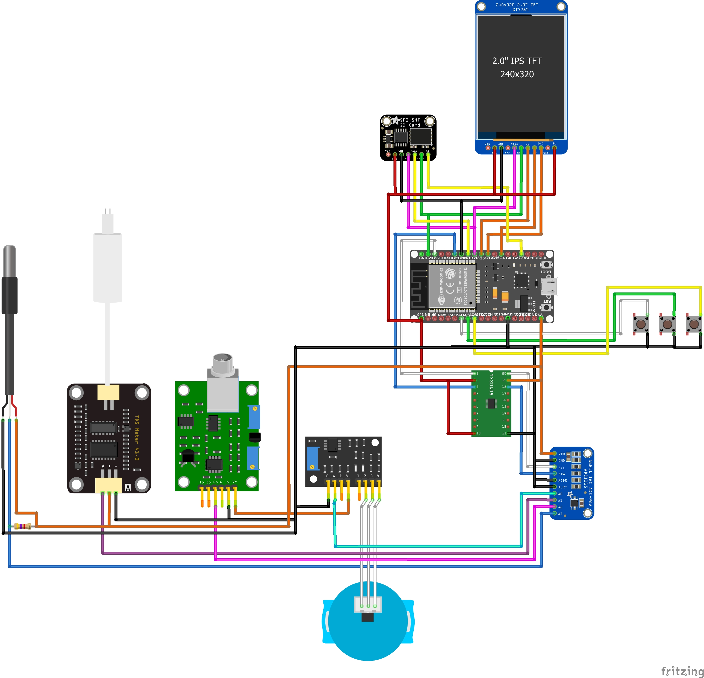

# Arquivos de hardware

| Pasta | Conteúdo |
| --- | --- |
| [images](images/) | Diagrama de montagem em JPG, exibido no README principal |
| [fritzing](fritzing/) | Circuito editável no Fritzing (`.fzz`) |
| [3d](3d/) | Peças do invólucro para visualização e impressão 3D (`.stl`) |

Abra [WaterQuality1.fzz](fritzing/WaterQuality1.fzz) no Fritzing para consultar o projeto editável. Os nomes originais dos arquivos STL foram preservados.

A pinagem e as divergências conhecidas estão no [README principal](../README.md), no [pinout](../docs/hardware/pinout.md) e na [planilha de ligações](../docs/hardware/pinout_WaterQuality.xlsx). Confira esses materiais e a montagem física antes de reproduzir o circuito.
